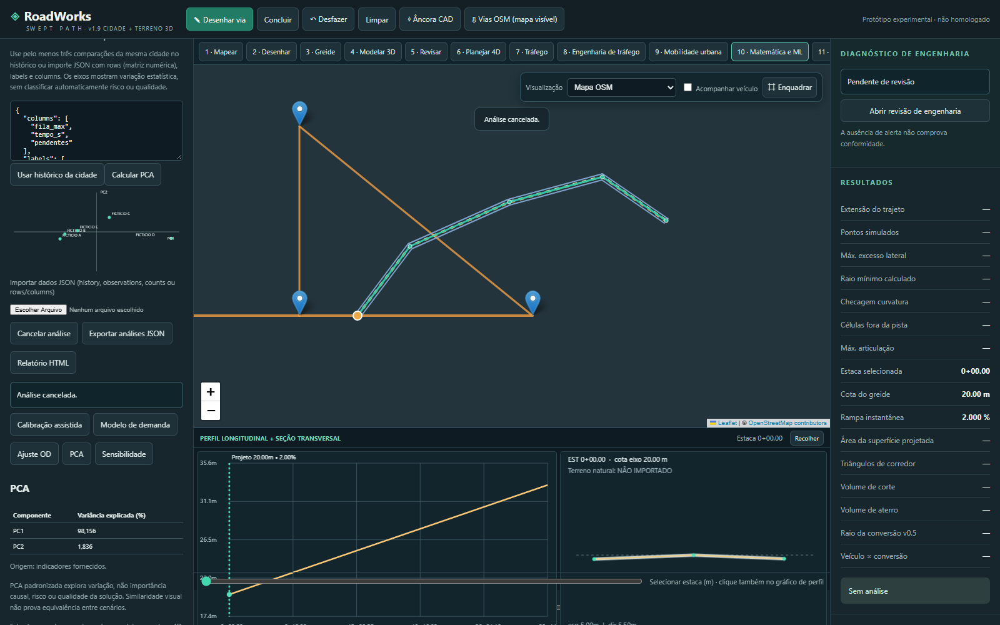

# RoadWorks Digital Twin

**Modelagem viária, visualização urbana 3D e simulação exploratória de trânsito no seu computador.**

O RoadWorks reúne ferramentas para estudar redes viárias, desenhar corredores, planejar obras e comparar cenários de mobilidade antes de uma intervenção. O projeto usa **Niterói, RJ, como piloto**, com cidades e áreas de estudo configuráveis.

**Versão atual: 1.9 — Cidade e terreno 3D.** Desenvolvido em JavaScript e Python, com execução local, interface no navegador e armazenamento em SQLite.

> Projeto experimental para estudo, pesquisa e análise preliminar. Os resultados dependem das fontes, das hipóteses e da calibração. O programa não declara homologação de engenharia nem equivalência completa ao Autodesk InfraWorks.

## Visão da aplicação

Rede cartográfica do OpenStreetMap no recorte piloto de Niterói sobre **terreno FICTÍCIO de demonstração**. A imagem não representa um levantamento topográfico da cidade.



## O que é possível fazer

| Área | Recursos disponíveis |
|---|---|
| Mapa e rede viária | Carregar vias OSM, identificar ruas, trabalhar com nós, sentidos, faixas e conversões permitidas |
| Cidade 3D | Gerar superfícies das vias, selecionar trechos por clique, mostrar nomes e alternar camadas |
| Terreno | Importar XYZ/CSV e GeoTIFF MDT; visualizar TIN/malhas, respeitando cobertura e NoData |
| Projeto geométrico | Desenhar eixos, retas, arcos e clotóides; configurar seções, perfis, PVIs e corredores |
| Verificação preliminar | Varredura veicular, interseções, alertas geométricos e estimativas de corte/aterro |
| Obras 4D | Organizar etapas e interdições por localização e período |
| Mobilidade urbana | Configurar viagens origem–destino, classes de veículos, ocupação e percentuais de demanda |
| Cenários de trânsito | Simular acidentes e obras temporários, configurar semáforos manualmente e comparar alternativas |
| Capacidade e filas | Examinar viagens concluídas/pendentes, tempos e filas; testar níveis de demanda contra critérios definidos |
| Matemática e ML | Sensibilidade, calibração assistida, regressão ridge temporal, ajuste OD não negativo e PCA |
| SUMO | Preparar e executar cenários locais em rede georreferenciada e importar resultados |
| Projetos e arquivos | Salvar revisões no SQLite; importar/exportar JSON; gerar CSV, GeoJSON, OBJ e relatórios, conforme o módulo |

Os detalhes e limites de cada ferramenta estão nos [guias de uso](#documentação).

## Requisitos

- **Python 3.12**: versão usada nas verificações registradas.
- Navegador atualizado; **Chrome ou Edge** são opções para uso local. A cena 3D exige WebGL disponível.
- Internet para mapas, consultas OSM e bibliotecas frontend carregadas por CDN. A distribuição não é totalmente offline.
- **Node.js 24**, se quiser executar os testes JavaScript; não é necessário para abrir a aplicação.
- **Eclipse SUMO**, opcional, para executar a microssimulação externa. Os testes de integração registrados usaram a versão 1.28.0.

Não há etapa obrigatória de build com npm. As novas análises numéricas rodam localmente no navegador, em Workers canceláveis, sem exigir GPU para os cálculos de ML.

## Instalação no Windows

Baixe ou clone o repositório. No PowerShell, entre na pasta da aplicação, que contém `index.html`, `requirements.txt` e `tools/`:

```powershell
cd roadworks_swept_path
python -m venv .venv
.\.venv\Scripts\python.exe -m pip install -r requirements.txt
.\.venv\Scripts\python.exe tools/launch.py
```

Depois da instalação inicial, abra **`Iniciar_RoadWorks.cmd`** para iniciar novamente.

O lançador abre o navegador, reconhece uma instância desta instalação e procura outra porta se a preferida estiver ocupada. Não encerra outros programas. O endereço habitual é [http://127.0.0.1:8000](http://127.0.0.1:8000); confira o endereço efetivamente informado no terminal.

Alternativas, executadas dentro da pasta da aplicação:

```powershell
# Iniciar sem abrir o navegador
.\.venv\Scripts\python.exe tools/launch.py --no-browser

# Procurar uma porta disponível a partir de 8001
.\.venv\Scripts\python.exe tools/launch.py --port 8001

# Executar a API diretamente em uma porta específica
.\.venv\Scripts\python.exe -m uvicorn tools.api:app --host 127.0.0.1 --port 8000
```

Para salvar no SQLite, utilize a aplicação pela API FastAPI. Abrir somente o HTML ou servir com `python -m http.server` não disponibiliza os endpoints de persistência.

## Primeiro estudo: das ruas do mapa à cidade 3D

1. Abra **9 · Mobilidade urbana**.
2. Clique em **Abrir recorte OSM de Niterói** para usar o exemplo cartográfico local. Para outra área, aproxime o mapa, clique em **Vias OSM (mapa visível)** e depois em **Usar OSM carregado**.
3. Abra **11 · Cidade 3D**, ou selecione **Rede urbana + terreno 3D** na visualização. Se a barra de etapas não couber na tela, role-a horizontalmente.
4. Selecione trechos por clique e confira sentidos, faixas e larguras. Os dados OSM podem estar incompletos; larguras de inicialização são hipóteses identificadas.
5. Importe um terreno com coordenadas e datum conhecidos. Sem MDT, a rede permanece em um plano de referência. O botão de terreno fictício serve somente para demonstração.
6. Cadastre demanda OD, controles e eventos. O recorte OSM distribuído não contém volumes de trânsito observados.
7. Compare cenários, examine também as viagens pendentes e salve uma revisão do projeto.

Na cena 3D: arraste para orbitar, use Shift+arraste ou botão direito para deslocar, a roda para zoom e duplo clique para enquadrar.

Para experimentar os métodos numéricos, abra **10 · Matemática e ML** e carregue os dados de demonstração **FICTÍCIOS**. Os exemplos de calibração e ajuste OD correspondem à rede fictícia A–B–C, disponível em **Novo exemplo fictício**; não são medições da rede OSM.

## Como interpretar as simulações

O projeto oferece ferramentas com escopos diferentes:

| Ferramenta | Interpretação |
|---|---|
| Prévia agregada de tráfego | Modelo simplificado de capacidade e filas de um corredor/desvio abstrato |
| Mobilidade urbana no navegador | Modelo mesoscópico determinístico com rotas, filas FIFO, armazenamento finito e eventos temporários |
| Integração SUMO | Execução externa de microssimulação sobre a rede preparada pelo projeto |

Nenhuma dessas modalidades se torna uma previsão validada de Niterói apenas por utilizar suas ruas. São necessários dados de demanda, controles, contagens, tempos e calibração/validação independentes.

No modelo urbano, as rotas usam tempo livre na partida; não há replanejamento durante a viagem ou mudança de faixa. Os semáforos são manuais e agregados por trecho. Para comparar mudanças de rede ou de plano semafórico, fixe o estudo de referência antes de editar.

A regressão usa separação temporal entre treinamento e teste. A calibração assistida separa os períodos de ajuste e validação. Melhor ajuste a dados sintéticos não comprova precisão em campo. A PCA explora variação estatística, sem demonstrar causalidade ou segurança.

## Executar o SUMO — opcional

Dentro da pasta da aplicação:

```powershell
.\.venv\Scripts\python.exe -m pip install eclipse-sumo
$env:PATH=(Join-Path $PWD '.venv\Scripts')+';'+$env:PATH

sumo --version
netconvert --version

.\.venv\Scripts\python.exe tools/urban_sumo.py samples/estudo_urbano_FICTICIO.json --output ../urban_run_01 --run
```

Use uma pasta de saída vazia por execução. Para apenas preparar arquivos, substitua `--run` por `--prepare-only`; essa opção não produz métricas de simulação. Depois de uma execução completa, importe `result.json` no painel urbano.

Fechamentos de faixas são exportados. O fator abstrato de capacidade do modelo mesoscópico não é convertido em um parâmetro equivalente fictício do SUMO. O pipeline atual também tem limites para pedestres, conexões por faixa e planos semafóricos: consulte o [guia de mobilidade](roadworks_swept_path/docs/URBAN_V17.md).

## Projetos, dados e exemplos

O banco padrão fica em `../roadworks_data/roadworks.db`, fora da pasta pública da aplicação. A variável de ambiente `ROADWORKS_DB` permite escolher outro caminho. Os projetos são locais, com revisões e histórico; a aplicação não oferece colaboração multiusuário.

O projeto completo admite snapshots de até **8 MB**. A cena 3D salva uma prévia reduzida do terreno, com origem e metadados. Preserve o arquivo original: a prévia não o substitui para volumes ou projeto executivo. **Projeto JSON** inclui o estado integrado; a exportação de estudo urbano isolado tem escopo menor.

Exemplos incluídos:

- [Rede OSM de Niterói sem demanda observada](roadworks_swept_path/samples/niteroi_rede_OSM_sem_demanda.json): 133 nós e 170 trechos direcionados.
- [Fonte e atribuição do recorte](roadworks_swept_path/samples/NITEROI_OSM_FONTE.md).
- [Estudo urbano fictício](roadworks_swept_path/samples/estudo_urbano_FICTICIO.json).
- [Demanda OD fictícia em CSV](roadworks_swept_path/samples/demanda_OD_FICTICIA.csv).
- [Demonstrações matemáticas e de ML fictícias](roadworks_swept_path/samples/analises_ML_FICTICIAS.json).

## Arquitetura

```text
roadworks_swept_path/
├── index.html, style.css          Interface no navegador
├── Iniciar_RoadWorks.cmd          Inicialização no Windows
├── src/
│   ├── app.mjs                   Integração dos módulos
│   ├── geometry.mjs, cad.mjs      Geometria e desenho de eixos
│   ├── vertical.mjs, corridor.mjs Perfis e corredores
│   ├── terrain.mjs, earthworks.mjs Terreno e volumes preliminares
│   ├── construction4d.mjs         Planejamento de obras
│   ├── urban-traffic.mjs          Rede, demanda e simulação urbana
│   ├── urban-analysis.mjs         Métodos numéricos e ML
│   └── urban-scene*.mjs,
│       urban-renderer.mjs         Cidade e terreno 3D
├── tools/                        FastAPI, SQLite, lançador e SUMO
├── tests/                        Testes JavaScript
├── samples/                      Exemplos e atribuição dos dados
└── docs/                         Guias, histórico e verificações
```

Frontend em JavaScript ES modules, Leaflet e Three.js, com GeoTIFF.js/Proj4 para os formatos suportados. Backend em Python/FastAPI com SQLite. A interface usa o mesmo servidor da API e a execução padrão fica em `127.0.0.1`.

## Testes

Execute dentro da pasta da aplicação:

```powershell
node --test tests/*.test.mjs

.\.venv\Scripts\python.exe -m pip install -r requirements-dev.txt
$env:PATH=(Join-Path $PWD '.venv\Scripts')+';'+$env:PATH
.\.venv\Scripts\python.exe -m unittest discover -s tools -p "test_*.py" -v
```

A [verificação registrada da versão 1.9](roadworks_swept_path/docs/VALIDACAO_V19.md) relata **277 testes JavaScript**, **24 testes Python** e os fluxos de cidade 3D, mobilidade e análise no navegador. Sem os executáveis SUMO no PATH, os testes correspondentes são explicitamente ignorados.

Os scripts opcionais `tools/browser_scene.cjs`, `tools/browser_urban.cjs` e `tools/browser_analysis.cjs` usam Playwright e Edge/Chromium. Configure uma API com banco exclusivo de QA antes de executá-los; eles criam projetos e revisões. As instruções estão nos guias e nos próprios scripts.

## Documentação

- [Cidade e terreno 3D — v1.9](roadworks_swept_path/docs/CIDADE_3D_V19.md).
- [Matemática, ML e uso local — v1.8](roadworks_swept_path/docs/ANALISE_LOCAL_V18.md).
- [Mobilidade urbana e SUMO — v1.7](roadworks_swept_path/docs/URBAN_V17.md).
- [Verificação v1.9](roadworks_swept_path/docs/VALIDACAO_V19.md), [v1.8](roadworks_swept_path/docs/VALIDACAO_V18.md) e [v1.7](roadworks_swept_path/docs/VALIDACAO_V17.md).
- [Histórico de desenvolvimento preservado](roadworks_swept_path/docs/HISTORICO_DESENVOLVIMENTO.md).

## Limites atuais

- Geometrias OSM e classificações por tags não equivalem a levantamento ou classificação funcional oficial.
- Sem MDT, `z=0` é referência. `layer`, `bridge` e `tunnel` não fornecem alturas; não são usados para inventar cotas de pontes/túneis.
- A cena urbana não gera automaticamente edifícios, calçadas e superfícies completas de cruzamentos, nem equivale a um editor BIM completo.
- Declividades, volumes e verificações dependem de CRS, datum, qualidade e cobertura dos dados. Ausência de alerta não comprova conformidade normativa.
- Não foi validada a capacidade operacional de toda a cidade. Os limites de tamanho, duração e memória estão documentados por módulo.
- Sensores, otimização automática de semáforos e nova extração automática de imagens/LiDAR ficaram fora desta evolução; recursos legados foram preservados.

## Contribuições

Relatos de problemas devem informar versão, etapas para reprodução, comportamento esperado e resultado observado. Exemplos pequenos e dados sintéticos identificados facilitam a análise. Alterações de código devem preservar os projetos existentes, acrescentar verificações relevantes e atualizar a documentação.

## Licença e atribuições

Ainda não há um arquivo `LICENSE` definindo a licença do código neste projeto. Este README não atribui uma licença ao software.

Os dados cartográficos OSM incluídos possuem atribuição **© OpenStreetMap contributors** e são disponibilizados sob ODbL, conforme o [registro da fonte](roadworks_swept_path/samples/NITEROI_OSM_FONTE.md). Bibliotecas, ferramentas externas e materiais de referência mantêm suas próprias licenças e condições de uso.
