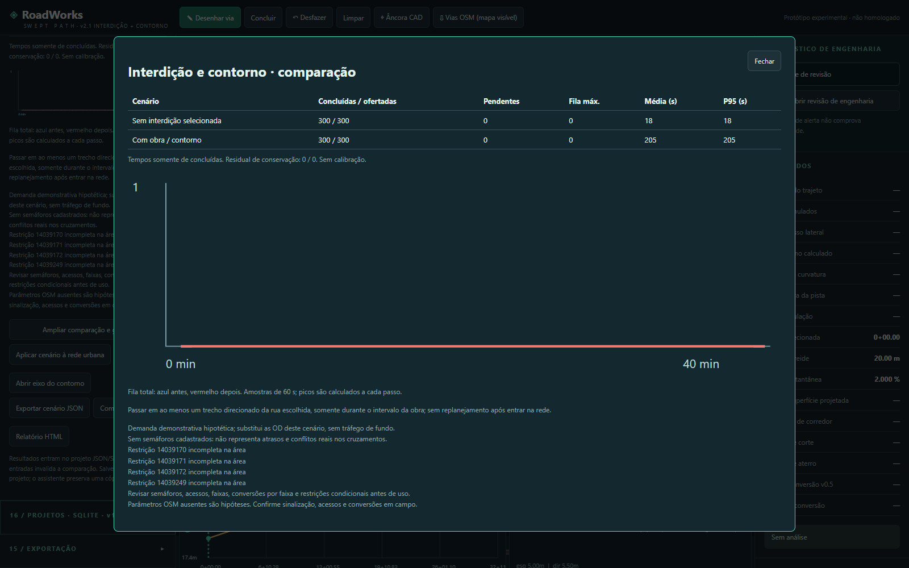

# Interdição e contorno no mapa — v2.1

O painel **13 · Interdição e contorno** integra busca, confirmação de local, seleção da interdição, passagem por uma rua e comparação. Não requer preparar arquivos JSON manualmente. O botão **Interditar / criar contorno**, junto ao editor de trecho urbano, abre o mesmo assistente.

## Uso rápido

1. Abra `Iniciar_RoadWorks.cmd` na raiz. Confira a porta informada pelo lançador. Atualize a página com **Ctrl+F5** para carregar a interface nova.
2. Abra **13 · Interdição e contorno**. Busque cidade, rua e número. Escolha um resultado, confira o marcador e pressione **Confirmar este local**. Se necessário, use **Ajustar ponto no mapa**, clique no ponto e confirme novamente. A confirmação é da posição escolhida, não validação do cadastro postal.
3. Clique em **Carregar vias desta área**. A consulta é limitada a um raio de 150–1.000 m. O programa tenta Overpass; se houver falha, tenta o XML da API OSM. Redes acima dos limites devem ser consultadas em uma área menor. Não há busca contínua ou download massivo.
4. Alternativamente, use **Usar rede atual**, sem busca de endereço, ou **Exemplo Palmier / Castrioto**. O exemplo contém geometria OSM, demanda hipotética e posição aproximada; o nº 443 não foi confirmado. Confirme ou ajuste o ponto antes de calcular.
5. Clique em **Selecionar trecho clicando na rede do mapa** e depois num segmento laranja. Também é possível filtrar ruas e escolher um trecho na lista. Defina interdição total/parcial e período em segundos dentro do horizonte da rede.
6. Escolha **segmento entre dois nós** ou **via OSM deste trecho**. A primeira opção abrange os sentidos cadastrados daquele par de nós. A segunda abrange todos os segmentos com o mesmo ID de way OSM, que não corresponde necessariamente à rua inteira.
7. Digite uma rua em **Passar pela rua** ou deixe vazio para contorno automático por menor tempo livre. Selecione a OD que usará a passagem, mantendo as demais como tráfego de fundo. Sem OD cadastrada, crie demanda **demonstrativa**, escolhendo origem, destino, veículos/h e fim do período. Essa modalidade substitui as OD somente na cópia do cenário e não inclui tráfego de fundo.
8. Use **Visualizar contorno** para conferir azul (referência), vermelho (interdição) e verde (contorno). Depois clique em **Comparar antes / depois**. A execução pode ser cancelada. Amplie a comparação para ler métricas e gráfico.
9. **Aplicar cenário à rede urbana** é uma ação explícita: atualiza a rede usada pelos painéis de mobilidade e cidade 3D. A base do assistente permanece congelada. **Abrir eixo do contorno** carrega o percurso no projeto geométrico; sem MDT, as cotas/greide continuam sendo hipóteses.
10. Salve uma revisão pelo painel SQLite. Exporte comparação CSV, relatório HTML ou cenário urbano JSON pelos botões do assistente.

## Comparação e hipóteses

A referência remove os eventos do trecho físico selecionado, conservando eventos de outros trechos. A alternativa acrescenta a obra e a passagem obrigatória escolhida. Intervalos e demanda são iguais entre os cenários. Os efeitos das demais OD não são descartados quando se usa uma OD existente.

O roteador procura uma rota que percorra **ao menos um trecho direcionado da rua indicada**, mantendo sentidos, modos, conexões por IDs de nós e `allowedNext`. Não basta colorir a rua no mapa: essa regra também entra no cálculo das viagens. Ela vale somente para a OD escolhida, durante a obra. Antes/depois do intervalo, as viagens podem voltar à rota livre. A rota é escolhida ao entrar na rede; veículos já em trânsito não recebem replanejamento dinâmico.

O estado de busca distingue o trecho atual e se a rua obrigatória já foi percorrida, evitando perder alternativas válidas ou concatenar caminhos com conversão proibida. A definição de extremos de uma via não aceita um retorno artificial para inverter o sentido escolhido. Vias ramificadas ou fechadas exigem definir extremos explicitamente.

Se não houver conexão, o mapa não inventa um caminho e o programa avisa. A simulação ainda pode mostrar viagens aguardando fora da rede; isso não é um contorno viável. O botão de aplicação exige um contorno encontrado. Retornos/repetições de nós geram aviso. OSM incompleto, sentidos presumidos e restrições ausentes continuam exigindo conferência em campo.

São mostrados viagens ofertadas/concluídas, pendentes, fila máxima, média e P95 de tempo das **concluídas**, gráfico de fila por minuto e residual de conservação. Fila zero em demanda sintética sem semáforos ou tráfego de fundo não demonstra fluidez real. O modelo continua mesoscópico, não calibrado, sem homologação de engenharia.

## Busca e precisão

O geocodificador Nominatim é acionado somente pelo botão, com intervalo mínimo de 1,1 s e cache local de cinco consultas. O assistente distingue retorno de rua/área de número predial cadastrado correspondente. Um número não encontrado permanece identificado como tal mesmo após você confirmar o ponto. Respostas inválidas, coordenadas ausentes, consultas de mais de 30 s ou acima de 6 MB são rejeitadas.

## Projetos e compatibilidade

- Extensão opcional do projeto: `detourAssistantV21`, schema `roadworks-detour-assistant/2.1`.
- Projeto principal: `roadworks-swept-path/1.6` e estudo urbano `roadworks-urban/1.7` preservados.
- OD pode conter `viaEdges`, `viaBegin` e `viaEnd`. O motor honra o período e invalida o cache de rotas em suas fronteiras.
- SQLite aceita e conserva esses campos. A exportação SUMO rejeita explicitamente OD com `viaEdges`; não descarta a regra silenciosamente.
- Rascunhos incompletos são salvos sem serem aprovados como configuração válida. Alterar entradas invalida os resultados; restaurar projeto exige executar a comparação novamente.
- Abrir uma nova aba com um projeto anterior no armazenamento local não permite que o exemplo inicial seja salvo automaticamente sobre ele. Abra o projeto existente ou salve explicitamente uma cópia nova.

## Teste automático com um comando

Execute **`Testar_RoadWorks.cmd`** na raiz ou:

```powershell
.\roadworks_swept_path\.venv\Scripts\python.exe tools/test_execution.py
```

Numa instalação nova, use `.venv\Scripts\python.exe`. São necessários Node.js, dependências de `requirements-dev.txt`, Playwright e Edge (ou `BROWSER_CHANNEL` compatível). Se Playwright estiver fora do projeto, indique `PLAYWRIGHT_MODULE`; o executador também reconhece o runtime local do Codex quando disponível. Não instala dependências automaticamente.

O executador roda testes Node, testes Python e cinco fluxos de navegador. Inicia sua própria API numa porta livre, com SQLite temporário, e encerra apenas a árvore de processos que criou. Nunca reutiliza o banco ou a URL de produção para os testes. Registra comandos, duração, contagens quando disponíveis, falhas, testes ignorados, logs e capturas em `roadworks_qa/automatico_.../report.json`. Retorna código diferente de zero se houver falha.

`--skip-browser` é uma opção explícita e fica registrada como teste ignorado, não como cobertura de navegador aprovada. Sem SUMO, seus testes podem ser ignorados conforme o ambiente; o relatório e os logs devem ser lidos antes de concluir que tudo foi exercitado.

O teste novo de navegador executa busca/confirmacão, fallback XML, interdição bilateral, seleção por clique real no mapa, contorno obrigatório, simulação, JSON/CSV/HTML, invalidação, aplicação, SQLite, restauração, cancelamento e proteção de projeto ao abrir outra aba. As respostas dos provedores externos são **simuladas nos testes** para reprodução; isso não certifica disponibilidade atual de Nominatim/Overpass. O lote e o motor de trânsito são executados de fato.

Núcleo e validação: `src/detour.mjs`, `tests/detour.test.mjs`. Interface/Worker: `src/detour-ui.mjs`, `src/detour-worker.mjs`. Orquestração: `tools/test_execution.py`, `tools/browser_detour.cjs`. Exemplo OSM: `samples/palmier_contorno_OSM_HIPOTETICO.json`, com atribuição em `samples/PALMIER_FONTE.md`.




Projetos com passagem obrigatória exigem v2.1 ou posterior para respeitar a regra; leitores antigos podem ignorar os campos opcionais. [Registro de verificação v2.1](VALIDACAO_V21.md).
