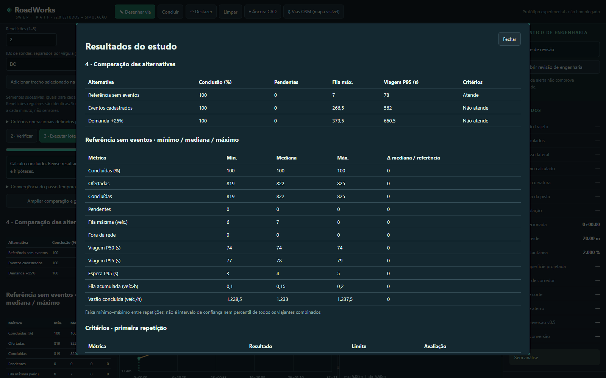

# Verificação RoadWorks 2.0

Data: 14/11/2026. Ambiente: Windows, Node.js 24, Python 3.12 no ambiente existente da aplicação, FastAPI/SQLite, Playwright com Edge e Eclipse SUMO 1.28.0. Os testes usam dados sintéticos ou o recorte cartográfico com procedência identificada. Não constituem validação de demanda ou tráfego observado de Niterói.

## Testes executados

| Grupo | Resultado |
|---|---|
| `node --test tests/*.test.mjs` | 292 aprovados, zero falhas, zero ignorados |
| `python -m unittest discover -s tools -p "test_*.py" -v` | 26 aprovados, incluindo execução real SUMO; nenhum teste ignorado |
| `tools/browser_study.cjs` | Base, lote Poisson, sementes, percentis/sondas, exportação JSON/CSV/HTML, duplicação, invalidação, convergência, seleção, comandos, câmeras 3D, SQLite, importação e cancelamento |
| `tools/browser_urban.cjs` | Comparação, edição, invalidação, saturação, exportação, SQLite e restauração sem eixo CAD |
| `tools/browser_analysis.cjs` | Sensibilidade, calibração/aplicação, resultado antigo, teste temporal, previsão, OD, PCA, cancelamento, relatórios e SQLite |
| `tools/browser_scene.cjs` | Seção, WebGL real, picking, 170 trechos OSM, MDT, camadas, altura visual, SQLite, XYZ e OBJ |

Os scripts de navegador verificam ausência de erros JavaScript. WebGL foi exercitado com o backend de software SwiftShader do Edge nos testes 3D; desempenho e disponibilidade da GPU do computador do usuário podem diferir. A API de QA usou exclusivamente `roadworks_qa/qa_v20.db`, sem gravar no banco de projetos do usuário.

## Cobertura nova

Os 15 testes de `tests/study-workbench.test.mjs` verificam: percentis; gerador com semente; compatibilidade das métricas regulares; reprodução Poisson e conservação nos três passos; integração de períodos fracionários; rejeição de opções inválidas; percentis ausentes; compilação sem mutar a base; limites; OD sem rota; lotes e estatísticas; critérios; convergência; workspace e hash.

Dois testes Python adicionais verificam a interface da raiz e a proteção das pastas privadas, incluindo caminhos com caixa diferente no Windows, e a persistência da extensão de estudos no SQLite. Os testes anteriores do projeto foram mantidos.

## Reproduzir nesta instalação

Execute da raiz `E:\bc_niteroi_rj\infraworks`:

```powershell
node --test tests/*.test.mjs
$env:PATH=(Join-Path $PWD 'roadworks_swept_path\.venv\Scripts')+';'+$env:PATH
.\roadworks_swept_path\.venv\Scripts\python.exe -m unittest discover -s tools -p "test_*.py" -v

# Terminal separado, somente banco de QA
$env:ROADWORKS_DB=(Join-Path $PWD 'roadworks_qa\qa_v20.db')
.\roadworks_swept_path\.venv\Scripts\python.exe -m uvicorn tools.api:app --host 127.0.0.1 --port 8765
```

Com Playwright instalado e Edge disponível, em outro terminal:

```powershell
$env:ROADWORKS_URL='http://127.0.0.1:8765'
# Se Playwright não estiver resolvível pelo Node, indique PLAYWRIGHT_MODULE.
node tools/browser_study.cjs
node tools/browser_urban.cjs
node tools/browser_analysis.cjs
node tools/browser_scene.cjs
```

Em instalação nova, use `.venv\Scripts` no lugar do caminho histórico. Dependências de testes estão em `requirements-dev.txt`. SUMO precisa estar no PATH para executar seus testes de integração.

## Limites verificados e limites de validade

Conservação igual a zero, reprodução de sementes e regressão funcional mostram consistência do software nos casos testados. Não demonstram precisão de campo, conformidade normativa, equivalência ao InfraWorks ou execução de análise estrutural SolidWorks. O estudo mesoscópico preserva as hipóteses e limitações descritas em [ESTUDOS_V20.md](ESTUDOS_V20.md).


